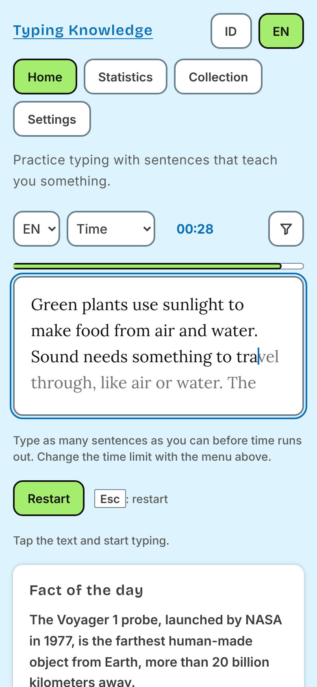
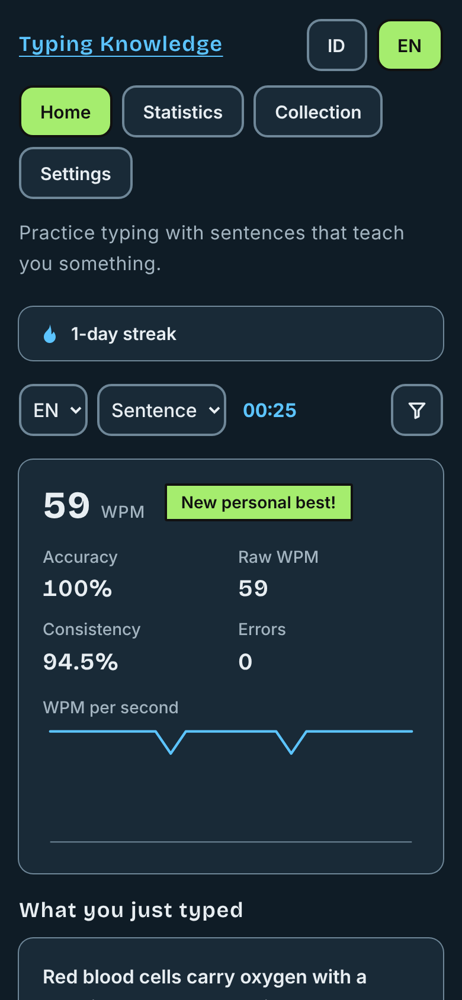

# curiotype

**curiotype** is a typing-test website that shows **meaningful sentences with real knowledge** (science, history, technology, health) instead of random words, in **Indonesian (default) and English**. Every sentence has a short explanation and a source.

[](https://github.com/mhmyu/curiotype/actions/workflows/ci.yml)    

<p align="center">
  
  &nbsp;&nbsp;
  
</p>

Stack: Astro 7 (static, Jamstack) + Svelte 5 islands + Tailwind CSS v4. No backend; all user data lives in the browser.

## Features

- **Five modes**: Time, Sentence, Count, Relaxed (no score) and Own text (paste your own).
- **Knowledge, not random words**: each sentence comes with an explanation and a source link; filter by category and by difficulty (easy or hard, measured from the text).
- **Progress**: speed and accuracy per test, personal bests, statistics, a keyboard heat map with your weak keys and a practice mode for them.
- **Habits**: daily streak and goal, fact of the day, favorites collection.
- **Share** your result as an image.
- **Works offline** as an installable app (PWA), light and dark themes, mobile-first and keyboard friendly.
- **Private by design**: no accounts, no tracking by default; everything is stored in your browser and can be exported or deleted.

## Quick start

```bash
corepack enable          # makes the pinned pnpm version available
pnpm install
pnpm dev                 # http://localhost:4321
```

Before the browser tests run for the first time: `pnpm exec playwright install chromium`.

## Requirements

- Node.js >= 22.23.4
- pnpm 12.15.0 (pinned in `package.json`; `corepack enable` installs it)

## Commands

| Command        | Action                                  |
| -------------- | --------------------------------------- |
| `pnpm install` | Install dependencies                    |
| `pnpm dev`     | Start the dev server                    |
| `pnpm build`   | Build the static site into `dist/`      |
| `pnpm preview` | Serve the production build locally      |
| `pnpm check`   | Type-check Astro and Svelte files       |
| `pnpm test`    | Run unit tests in watch mode (Vitest)   |
| `pnpm test:run`| Run unit tests once (used by CI)        |
| `pnpm test:e2e`| Run browser tests (build first)         |
| `pnpm assets:generate` | Regenerate favicon, icons and Open Graph images |
| `pnpm content:stats` | Count sentences per language, category and difficulty; show the score spread (`--scores`: the score and level of every sentence); warn below 100 or off 50/50 |
| `pnpm content:check-sources` | Request every source URL and report broken links (needs a network) |

## Project structure

```
src/
  content/sentences/<lang>/<category>.json   # sentence corpus (see "Content format")
  content.config.ts                          # Zod schema for the corpus
  config/                                    # public configuration from env vars (parse.ts pure parsers, site.ts) and the Lora font subsets (font-subsets.ts)
  pages/
    [lang]/index.astro                       # home page: /id/ and /en/ (/ redirects to /id/)
    [lang]/stats.astro                       # statistics page: /id/stats/ and /en/stats/
    [lang]/collection.astro                  # collection page: /id/collection/ and /en/collection/ (saved sentences)
    [lang]/settings.astro                    # settings page: /id/settings/ and /en/settings/ (settings + data tools)
    [lang]/privacy.astro                     # privacy policy: /id/privacy/ and /en/privacy/
    data/[lang]/sentences.json.ts            # static JSON endpoint consumed by the island
    404.astro                                # one bilingual "not found" page
    robots.txt.ts                            # robots.txt (needs the public origin, so it is generated)
  layouts/ components/                       # Astro shell (header, main navigation, language switcher, footer)
  i18n/                                      # languages, Dictionary type, id/en UI strings
  lib/
    taxonomy.ts                              # categories + difficulties (single source of truth)
    difficulty.ts                            # sentence score, per-language thresholds, classifyDifficulty (pure, tested; imported by the build rules and by content:stats)
    content-langs.ts                         # sentence languages found from the folders under content/sentences (pure, tested)
    language-names.ts                        # language names for the sentence language switch via Intl.DisplayNames (pure, tested)
    sentence-corpus.ts                       # flattens one language's files, checks path/id/text duplicates (pure, tested)
    seo.ts                                   # canonical/hreflang URLs, JSON-LD, robots.txt content (pure, tested)
    csp.ts                                   # hash of an inline script for the Content Security Policy (build time only)
    types.ts                                 # Sentence, TestSettings, ModeId
    storage/                                 # StorageAdapter contract (get/set/remove/keys/clear) + localStorage adapter (+ in-memory adapter for tests)
  features/
    typing-area/    TypingArea.svelte        # presentational: text per character + transparent input
    typing-test/    TypingTest.svelte        # the interactive island (UI + flow only)
    typing-engine/  engine.ts, accents.ts, metrics.ts, key-stats.ts  # pure typing state, NFC/accent handling, WPM/accuracy math, per-key stats (+ *.test.ts)
    test-modes/                              # one file per mode behind the TestMode contract
    sentence-picker/                         # filtering, no-repeat shuffled queue, weak-key-picker.ts (practice pool)
    results/                                 # results panel, WPM chart, SentenceCard (sentence + explanation + source, shared with the collection), "what you just typed", share image (share-image.ts, share-result.ts, share-button-state.ts)
    history/                                 # history list and personal bests
    seen/                                    # ids of sentences typed to the end (seen.ts)
    relaxed/                                 # relaxed mode: relaxed-session.ts (pure session state), RelaxedSession.svelte
    custom-text/                             # custom text: normalize.ts, custom-texts.ts (saved texts), CustomTextInput.svelte
    shortcuts/                               # shortcuts.ts: pure rules for the Esc / Enter shortcuts of the result screens
    favorites/                               # saved sentences: favorites.ts (pure + storage), FavoriteButton (star), CollectionPage (collection island)
    sound/                                   # typing-sound.ts: WebAudio click (lazy context, pure gain helper, tested)
    daily-fact/                              # fact of the day: daily-fact.ts (pure, tested), DailyFact (card on the home page)
    stats/                                   # statistics: stats.ts and weak-keys.ts (pure, tested), StatsPage (island), TrendChart (inline SVG)
    data-tools/                              # data export / import / delete (data-schema.ts, data-transfer.ts, DataTools.svelte)
    settings/                                # Settings type, defaults, load/save, shared reactive store, theme (theme.ts), settings page UI (SettingsPanel), sentence language switch
  styles/                                    # global.css (Tailwind mapping, type scale, base rules), tokens.css (colors)
public/                                      # favicon.svg, apple-touch-icon.png, icons/, og/ (generated; see "Brand assets" in `ARCHITECTURE.md`), _headers (host headers; see "Deploy" in `ARCHITECTURE.md`)
scripts/generate-assets.mjs                  # draws the brand assets from the design palette
scripts/content-stats.ts, check-sources.ts   # content tools (`pnpm content:stats`, `pnpm content:check-sources`); read-corpus.ts is their shared file reader
tests/e2e/                                   # Playwright browser tests
.github/                                     # CI workflow, issue and pull request templates, dependabot.yml
ARCHITECTURE.md CONTENT_GUIDE.md CONTRIBUTING.md   # technical notes; sentence writing rules; how to contribute
MAINTAINING.md SECURITY.md                   # owner's handbook; how to report a vulnerability
```

## Content format

One file per language and category: `src/content/sentences/<lang>/<category>.json`.

```json
{
  "lang": "id",
  "category": "science",
  "items": [
    {
      "id": "id-science-001",
      "difficulty": "easy",
      "text": "The sentence the user types.",
      "explanation": "One or two sentences of context shown after the test.",
      "source": { "title": "Source name", "url": "https://example.com/page" }
    }
  ]
}
```

Want to add sentences? See [`CONTRIBUTING.md`](CONTRIBUTING.md). Writing rules (how the difficulty is measured, sources, typing-friendly characters, review checklist) are in [`CONTENT_GUIDE.md`](CONTENT_GUIDE.md).

Rules enforced at build time (the build fails with a message naming the sentence and the rule):

- `lang` and `category` must match the file path; `id` looks like `<lang>-<category>-001` and is unique across all files; no two sentences share the same text.
- `text` length must fit the range of its language, its `difficulty` must be the level its score gives (see "Difficulty" below), and it must use only the characters allowed for its language (printable ASCII unless the language has its own rule, see "Adding a sentence language" in `ARCHITECTURE.md`), be Unicode NFC, use single spaces, and end with a full stop.
- `explanation` is 40-220 characters; `source.title` looks like `Publisher: Page title`; `source.url` is a public `https://` link.

The numbers live in one place, `src/lib/content-rules.ts` (and `src/lib/difficulty.ts` for the difficulty). Whether a fact is true, whether the source supports it, and topic variety are judged by reviewers.

### Difficulty

There are **two levels, `easy` and `hard`** (`DIFFICULTIES` in `lib/taxonomy.ts`), and a sentence's level is **measured, not chosen** (`lib/difficulty.ts`, pure and tested). The score of a sentence is its length in characters plus `3` per digit, `2` per capital letter that is not the first character, `2` per character that is not a letter, a digit or a space (except the final full stop), and `5` per word of 10 letters or more (`DIFFICULTY_WEIGHTS`). A sentence is `easy` when its score is **below the threshold of its language** and `hard` at or above it (`DIFFICULTY_THRESHOLDS`: `en` 100, `id` 120; a language without an entry uses `en`). The build rejects a `difficulty` that differs from the level its score gives, with a message such as `"id-science-007": score 132 is hard (threshold for "id" is 120), but difficulty is "easy"`; `pnpm content:stats --scores` lists the score and level of every sentence, so an author can check a label before opening a pull request. The length range (`TEXT_LENGTH`: `en` 50-170, `id` 55-190) is now one sanity range per language, not per level. The target mix is 50% easy and 50% hard in every category. **The weights and thresholds are a starting point** calibrated on the 40 sample sentences (median score `en` 100, `id` 120): recalibrate when a language nears 100 sentences per category (`pnpm content:stats` prints the median of each language next to its threshold; moving a threshold changes the level of every sentence, so relabel with `--scores`). In the interface the filter offers All, Easy and Hard, a short note under it explains the chosen level (`test.difficultyEasyHint`, `test.difficultyHardHint`), and the sentence cards (results, collection, relaxed mode) show the level as a small badge with its name (never colour alone). There is **no migration** (the site was not public yet): a history entry or an export file that still says `medium` is dropped or rejected by the strict parsers.

> The shipped sentences are **sample data** to exercise the flow. Their sources point to English Wikipedia pages for both languages. Verify every fact and replace the sources before release.

## Environment variables

Copy `.env.example` to `.env` for local use, or set the same names in the hosting dashboard (a real environment variable wins over the files). All of them are optional; `.env` files are git-ignored.

| Variable          | Example                              | Effect when set                                                                                         | When empty                                   |
| ----------------- | ------------------------------------ | ------------------------------------------------------------------------------------------------------- | -------------------------------------------- |
| `SITE_URL`        | `https://typing.example.com`         | Canonical and `hreflang` links, `og:url`, `og:image`, JSON-LD, `sitemap-index.xml`, `Sitemap:` in `robots.txt` | Those tags and the sitemap are left out      |
| `PUBLIC_REPO_URL` | `https://github.com/mhmyu/curiotype` | Footer repository link and the "Report a wrong fact" links under each sentence                          | Those links are hidden                       |
| `PUBLIC_ANALYTICS_CLOUDFLARE_TOKEN` | `0123456789abcdef0123456789abcdef` | Loads Cloudflare Web Analytics in production; allows its two hosts in the CSP; privacy page describes it | No analytics, CSP has only `'self'`, privacy page says so |

`SITE_URL` is the origin only (a path, query or hash is dropped); an invalid value is ignored and the build prints a warning. `PUBLIC_REPO_URL` must be a GitHub repository root. `PUBLIC_ANALYTICS_CLOUDFLARE_TOKEN` is the Cloudflare Web Analytics site token (letters, digits, `-`, `_`, 16-64 characters; anything else is ignored with a build warning). See "Analytics" below and "Deploy" for the variables the host needs besides these.

## Deploy

The site is static: `pnpm build` writes everything to `dist/`, and any static host can serve it. The recommended host is **Cloudflare Pages** (build command `pnpm build`, output directory `dist`). Security headers and the Content Security Policy are part of the build. Step-by-step instructions are in [`MAINTAINING.md`](MAINTAINING.md); the technical details are in [`ARCHITECTURE.md`](ARCHITECTURE.md).

## Contributing and maintenance

- [`ARCHITECTURE.md`](ARCHITECTURE.md): how each feature works, how to extend it (languages, modes), deploy details and analytics.
- [`CONTRIBUTING.md`](CONTRIBUTING.md): how to suggest or add sentences and change code.
- [`CONTENT_GUIDE.md`](CONTENT_GUIDE.md): the sentence writing rules.
- [`MAINTAINING.md`](MAINTAINING.md): the handbook for the repository owner (setup, deploy, review, routine, rollback, troubleshooting).
- [`SECURITY.md`](SECURITY.md): how to report a vulnerability privately.
- `.github/dependabot.yml`: weekly grouped dependency updates (minor and patch in one pull request, each major update separate) and monthly updates of the GitHub Actions.

## License

- **Code, configuration, UI strings and documentation**: [MIT](LICENSE).
- **Sentence corpus** (`src/content/sentences/`): [CC BY-SA 4.0](LICENSE-CONTENT). Reuse requires attribution and sharing adaptations under the same license.
